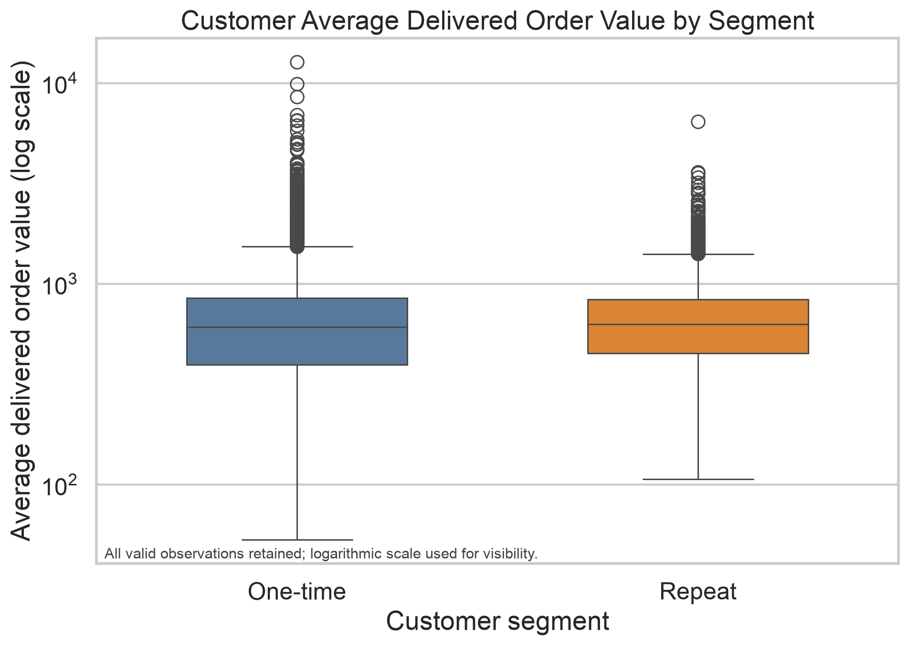
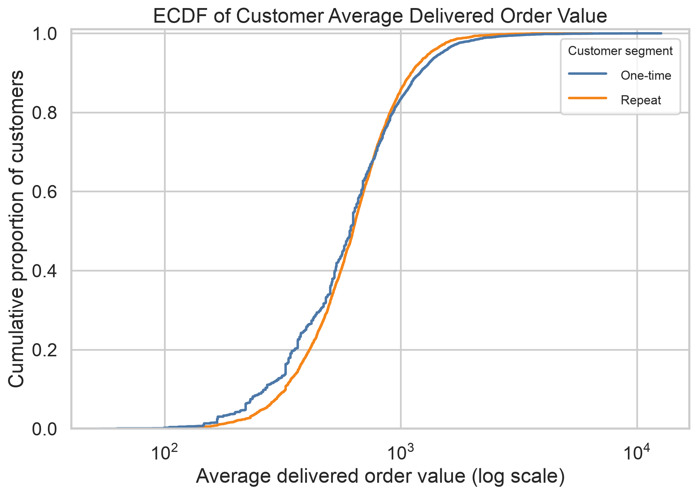
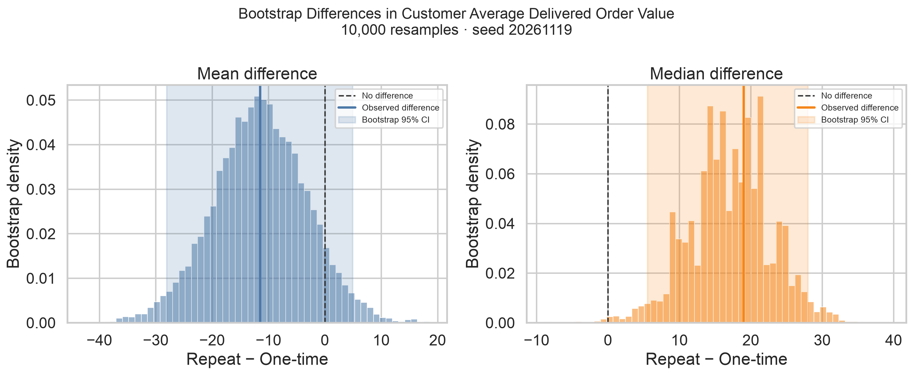

# Statistical Hypothesis Testing — Customer Spending Analysis

## Objective

Determine whether customer-level average delivered order value differs between one-time and repeat customers.

This is an observational comparison, not an experiment or A/B test. All directional estimates use **Repeat − One-time** consistently. The analysis uses two-sided tests with `α = 0.05` and preserves every valid extreme observation.

## Data Source and Analytical Grain

- Database: `food_delivery_analytics`
- Source table: `public.clean_orders`
- Source columns: `customer_id`, `order_id`, `order_status`, and `total`
- Included status: `Delivered` only
- Extracted grain: one row per eligible customer
- Customer outcome: arithmetic mean of `total` across each customer's Delivered orders
- One-time customer: exactly 1 Delivered order
- Repeat customer: 2 or more Delivered orders

The version-controlled extraction is `sql/06_customer_spending_extraction.sql`. Customer-level data is held in memory during execution and is not written to the repository.

## Reproducible Implementation

- Analysis workflow: `python/customer_hypothesis_testing.py`
- Dependencies: `requirements.txt`
- Bootstrap resamples: 10,000
- Bootstrap random seed: `20261119`
- Confidence interval method: two-sided percentile interval using the 2.5th and 97.5th bootstrap percentiles
- Significance threshold: `α = 0.05`

The script connects directly to PostgreSQL using `DATABASE_URL` or the standard `PGDATABASE`, `PGUSER`, `PGPASSWORD`, `PGHOST`, and `PGPORT` environment variables. No credentials are hardcoded.

## Data Validation

All extraction and descriptive benchmarks passed before inferential analysis ran.

| Validation metric | Expected | Actual | Result |
|---|---:|---:|---|
| Delivered orders | 21,131 | 21,131 | Passed |
| Eligible customers | 11,545 | 11,545 | Passed |
| One-time customers | 7,691 (66.62%) | 7,691 (66.62%) | Passed |
| Repeat customers | 3,854 (33.38%) | 3,854 (33.38%) | Passed |
| Missing delivered order values | 0 | 0 | Passed |
| Non-positive delivered order values | 0 | 0 | Passed |
| Minimum order value | 52.50 | 52.50 | Passed |
| Maximum order value | 12,663.00 | 12,663.00 | Passed |
| Overall order-level average | 682.57 | 682.57 | Passed |

The current run also reproduced every previously validated segment count, mean, median, standard deviation, quartile, and skewness value within the defined numerical tolerance.

## Descriptive Statistics

The table summarizes customer-level average delivered order value, not individual orders.

| Customer segment | Customers | Mean | Median | Standard deviation | Minimum | Q1 | Q3 | Maximum | Skewness |
|---|---:|---:|---:|---:|---:|---:|---:|---:|---:|
| One-time | 7,691 | 699.62 | 609.00 | 506.64 | 53.00 | 394.90 | 848.66 | 12,663.00 | 5.64 |
| Repeat | 3,854 | 688.13 | 628.02 | 365.51 | 106.45 | 450.71 | 834.40 | 6,418.12 | 2.73 |

Observed directional differences:

- Arithmetic mean: **−11.492734**, or **−1.642715%** relative to the one-time mean.
- Median: **+19.022500**, or **+3.123563%** relative to the one-time median.
- The signs differ because the one-time distribution has greater dispersion, stronger right skew, and more extreme high values.

## Formal Hypotheses and Methods

### Analytical Plan Evolution

The original analysis plan selected the Mann–Whitney U test because customer average delivered order values are strongly right-skewed and contain valid extreme observations. That choice provides a useful rank-based comparison without requiring normal distributions, so it remains part of the final analysis with Cliff's delta as its effect size.

However, the research question explicitly asks whether **average** delivered order value differs. In this project, “average” is defined as the arithmetic mean. Mann–Whitney does not directly test equality of arithmetic means—and, without additional shape assumptions, it does not directly test equality of medians either. Welch's t-test on the original customer-level values was therefore added as the primary test of the arithmetic-mean estimand. Welch's form is appropriate because it allows unequal variances, which the descriptive statistics and Brown–Forsythe test support. The Mann–Whitney result remains a complementary distributional/rank result rather than a substitute for the mean test.

### Mann–Whitney U Test

- **Null hypothesis:** The relative effect is 0.5: the probability that a repeat-customer value exceeds a one-time-customer value, plus half the probability of a tie, equals 0.5.
- **Alternative hypothesis:** The relative effect differs from 0.5, indicating a difference in stochastic tendency.
- **Method:** Two-sided, asymptotic Mann–Whitney U test because the samples are large and contain ties.
- **Effect size:** Cliff's delta, signed as Repeat − One-time.

Mann–Whitney does **not** directly test equality of medians. A median interpretation would require additional distribution-shape assumptions that are not supported here.

### Welch's t-Test on Original Values

- **Null hypothesis:** `μ_repeat − μ_one-time = 0` for arithmetic customer-level average delivered order value.
- **Alternative hypothesis:** `μ_repeat − μ_one-time ≠ 0`.
- **Method:** Two-sided Welch's t-test, which does not assume equal variances.
- **Effect size:** Bias-corrected Hedges' g, signed as Repeat − One-time.

This is the primary inferential test for the stated arithmetic mean question.

### Welch's t-Test on Natural-Log Values

- **Null hypothesis:** `E[ln(X_repeat)] − E[ln(X_one-time)] = 0`.
- **Alternative hypothesis:** `E[ln(X_repeat)] − E[ln(X_one-time)] ≠ 0`.
- **Method:** Two-sided Welch's t-test after applying the natural logarithm to positive customer averages.
- **Effect size:** Hedges' g on the log scale, signed as Repeat − One-time.

This is supplementary. It assesses proportional/log-scale differences and is not a replacement for the arithmetic mean test.

### Brown–Forsythe Test

- **Null hypothesis:** The population variances of customer average delivered order value are equal across segments.
- **Alternative hypothesis:** The variances differ.
- **Method:** Median-centered Levene test, commonly called the Brown–Forsythe test.
- **Effect summary:** Sample variance ratio, Repeat / One-time.

### Bootstrap Confidence Intervals

Customers were resampled independently with replacement within each segment. Each resample calculated Repeat − One-time mean and median differences. The fixed seed makes the 10,000-resample percentile intervals reproducible.

## Hypothesis-Test Results

| Analysis | Statistic | Degrees of freedom | Numerical p-value | Effect | Effect value | Significant at 0.05? |
|---|---:|---:|---:|---|---:|---|
| Mann–Whitney U | 15,412,572.5 | — | 0.000455528465104 | Cliff's delta | +0.0399455634495 | Yes |
| Welch t-test, original values | −1.39329063736 | 10,136.048 | 0.163562472532 | Hedges' g | −0.024749826185 | No |
| Welch t-test, natural-log values | +3.96255773121 | 9,075.389 | 0.0000747190175732 | Hedges' g, log scale | +0.073586757357 | Yes |
| Brown–Forsythe | 48.1743814897 | 1 and 11,543 | 0.00000000000410841030431 | Variance ratio, Repeat / One-time | 0.520487483019 | Yes |

Welch degrees of freedom are generated by SciPy and shown to three decimals for readability. P-values are reported numerically rather than only as threshold statements.

## Bootstrap Results

| Estimate | Observed difference | Percentage difference | Bootstrap 95% CI | Excludes zero? |
|---|---:|---:|---:|---|
| Arithmetic mean, Repeat − One-time | −11.492734 | −1.642715% | [−28.075374, 4.889800] | No |
| Median, Repeat − One-time | +19.022500 | +3.123563% | [5.512500, 27.977778] | Yes |

The mean interval agrees with the original-scale Welch test: the observed arithmetic mean difference is small and the interval includes zero. The median interval is positive, but it should be interpreted as a descriptive location result rather than as a reinterpretation of the Mann–Whitney test.

## Supplementary Log-Scale Result

The log-scale Welch test is statistically significant. The one-time geometric mean is **585.952416**, and the repeat geometric mean is **610.623512**, a **+4.210426%** Repeat − One-time difference. This small proportional shift appears after reducing the influence of extreme right-tail values. It does not contradict the absence of evidence for an arithmetic mean difference because the two tests target different estimands.

## Effect-Size Interpretation

- Cliff's delta of **+0.03995** indicates only a very small tendency for a randomly selected repeat customer to have a higher customer average than a randomly selected one-time customer.
- Original-scale Hedges' g of **−0.02475** is negligible.
- Log-scale Hedges' g of **+0.07359** is also very small despite statistical significance.
- The repeat-group sample variance is about **52.05%** of the one-time-group variance, a material dispersion difference that supports using unequal-variance methods.

With more than 11,000 customers, small distributional differences can produce small p-values. Statistical significance therefore should not be treated as evidence of meaningful business magnitude.

### Statistical Significance, Effect Size, and Practical Significance

- **Statistical significance** answers whether the observed evidence is inconsistent with a specified null hypothesis at `α = 0.05`. It does not describe how large or useful a difference is.
- **Effect size** quantifies magnitude and direction. Here, Cliff's delta and both Hedges' g estimates are very small even when their associated tests are significant.
- **Practical significance** asks whether the magnitude warrants a business response. The primary mean difference is only −1.64%, its confidence interval includes zero, and the significant complementary effects are small; the analysis alone does not support materially different spending policies for the two segments.

## Distribution Evidence

### Box Plot



The logarithmic scale retains all valid extreme observations while keeping the central distributions visible. Repeat customers show a slightly higher median and a narrower distribution; one-time customers have a longer upper tail.

### Empirical Cumulative Distributions



The ECDF curves are close and cross, reinforcing that the group difference is not a simple uniform shift. The curve separation is small, consistent with the small Cliff's delta.

### Bootstrap Confidence Intervals



The arithmetic mean distribution spans zero, while the median interval lies above zero. All valid observations were retained in the analysis and resampling.

## Overall Interpretation

The primary arithmetic mean analysis does not reject its null hypothesis at `α = 0.05` (`p = 0.163562472532`). The data do not provide statistically significant evidence that repeat and one-time customers differ in arithmetic mean customer-level average delivered order value.

The Mann–Whitney and log-scale Welch tests detect statistically significant distributional or proportional differences, but their effect sizes are very small. Repeat customers have a modestly higher median and a more concentrated distribution, while extreme high customer averages in the one-time group raise its arithmetic mean. The Brown–Forsythe result confirms unequal dispersion.

These findings are compatible rather than contradictory because the tests target different population features.

## Evidence-Based Business Recommendations

- Do not assume repeat customers place higher-value orders on average. The primary arithmetic mean comparison shows a small −1.64% difference with a confidence interval that includes zero.
- Treat repeat status as a retention/frequency characteristic, not proof of higher per-order spending. Customer total value over time is a different business question and is not estimated by this outcome.
- Focus basket-value initiatives on observable purchasing patterns and product mix rather than segment membership alone; the detected segment effects are too small to support materially different spending policies by themselves.
- Monitor typical value and dispersion alongside the mean. The observed repeat distribution is narrower and has a slightly higher median, while the one-time segment contains more extreme upper-tail values; part of the variance difference is mechanically induced by averaging more orders for repeat customers.
- Re-estimate the analysis over a longer observation window and by customer acquisition cohort before using the findings for targeting decisions.
- If operationally important, extend the analysis with prespecified covariates such as restaurant brand, geography, discount exposure, and ordering period. Such modeling may reduce confounding but still would not establish causality without an appropriate design.

## Limitations

- **Observational data:** Segment membership was not randomized. Unmeasured differences may explain spending patterns, so no causal claim is supported.
- **Unequal customer order frequencies:** One-time customer averages contain one observation, while repeat customer averages combine two or more orders. Their measurement precision differs.
- **Aggregation-induced variance differences:** Averaging multiple orders mechanically reduces within-customer noise for repeat customers, contributing to their lower customer-level variance independently of behavioral consistency.
- **Finite observation window:** A customer labeled one-time may order again outside the dataset period, and a repeat customer's prior or future activity may be unobserved.
- **Group-size imbalance:** The one-time segment is approximately twice the size of the repeat segment.
- **Right skew and extremes:** Both distributions are right-skewed, especially the one-time segment. Extreme values were retained because they passed data-quality checks.
- **Multiple inferential views:** Several tests answer different questions. Their p-values should not be selectively interpreted as interchangeable evidence about arithmetic means.
- **Metric scope:** Delivered order value is not an accounting or customer-lifetime-value measure.

## Run Instructions

```text
python3 -m venv .venv
.venv/bin/python -m pip install -r requirements.txt
.venv/bin/python python/customer_hypothesis_testing.py
```

The script validates the extraction and historical descriptive results before running any inferential analysis. It prints test statistics, numerical p-values, effect sizes, bootstrap intervals, percentage differences, and figure paths. No customer-level file is persisted.
